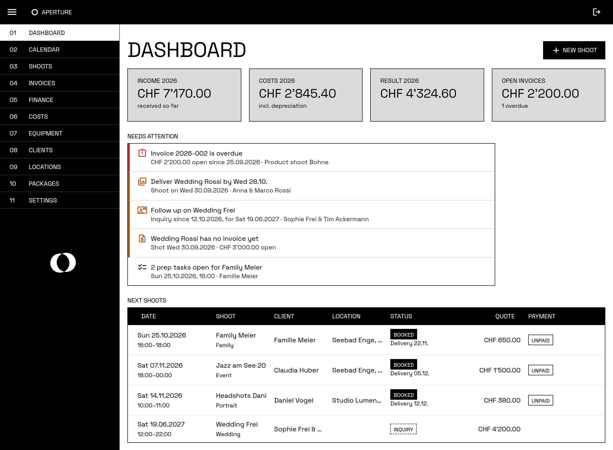

# Aperture

A small ERP for running a photography business: shoots, clients, deliveries, costs, invoices (Swiss QR-bill) and tax exports.
Single user, CHF, English or German. It runs on the photographer's own computer (macOS, Windows or Linux), installed with a
double-click; it opens in its own window there, a browser's app mode without tabs or address bar. It only runs while
it's used: a minute after its window is closed it stops, and opening it starts it again.



**Install:**
- **macOS** (Apple silicon, macOS 15 or newer): [Aperture-Installer.pkg](../../releases/latest/download/Aperture-Installer.pkg)
- **Windows** (10 or 11, 64-bit): [Aperture-Setup.exe](../../releases/latest/download/Aperture-Setup.exe)
- **Linux** (x64, systemd): the `linux-x64` package from the [latest release](../../releases/latest), then `install.sh`

Details in [docs/deployment.md](docs/deployment.md).

**Stack:** .NET 10 · Blazor Web App (Interactive Server) · Radzen.Blazor · EF Core + SQLite

## What it does

| Area | |
|---|---|
| **Shoots** | Client, location, date and time (several shoots per day, shoots past midnight), status *Inquiry → Booked → Shot → Delivered* or *Cancelled*, shoot type, quote. |
| **Packages** | Your price list (e.g. *Wedding full day*, CHF 3'800, 10 hours, delivery in 6 weeks). Picking one on a shoot fills in type, quote, end time, delivery date and what's included; the invoice names it. |
| **Shoot finances** | Costs such as gear rental, either covered by the quote or billed on top (at cost or with your margin). *Add train trip* enters the SBB ticket there and back, with the fare you paid last time to the same location. Payments received, with the payslip attached. Margin and what's still open. |
| **Delivery** | A delivery date per shoot, suggested from your usual delivery time (Settings), and a link to the client gallery. |
| **Prep** | Moodboard and reference links (Pinterest, Google Drive, …), notes, a checklist (wedding, portrait, event and commercial templates, the one for the shoot type offered first), files. |
| **Calendar** | Month, week and year view. Hovering over a shoot shows a card with the details. *Add to calendar* on a shoot puts it in the computer's calendar app (and with a synced calendar on the phone). |
| **Quotes** | A PDF offer for a shoot: package and price, extra lines, what's included, valid for 30 days. Numbered `Q-2026-001` once finished and archived with the shoot's files. Marking it accepted books the shoot at the quoted price; declined cancels the inquiry. Changes go into a new version. |
| **Invoices** | Created from a shoot: quote plus billed costs, optional VAT, rounded to 5 Rappen, Swiss QR-bill. Numbered `2026-001` once issued, then frozen and archived as PDF. |
| **Finance** | Income statement per year on a cash basis, business costs that don't belong to a shoot, equipment with depreciation. |
| **Tax export** | Per year, one ZIP: the statement as PDF, every line as Excel, and all receipts, payslips and invoices, numbered to match. |
| **Dashboard** | Year figures and a to-do list: overdue invoices, deliveries due or overdue, inquiries waiting a week for an answer or whose date has passed, shoots without an invoice, open prep, backup problems. |
| **Notifications** | In the browser on the computer, while Aperture runs (a few minutes after login, and while its window is open): overdue invoices, deliveries due within a week or overdue, inquiries waiting a week, open prep three days before a shoot, backup problems and new versions. |
| **Language** | English or German (Swiss: *Rechnung*, *MWST*, *Offerte*), chosen in Settings; until then the browser's language. Invoices start in that language and can be switched per invoice on the shoot's Invoice tab, so a German-speaking photographer can still send an English invoice: the PDF and its QR-bill follow it. The tax export and notifications follow Aperture's language. |
| **Backups** | Daily into the install folder's `backups` (and any external drive or synced folder you add), picked up by Time Machine or File History. *Download a backup* in Settings gets everything as one ZIP, e.g. to move to a new computer. |

How the numbers are calculated: [docs/accounting.md](docs/accounting.md).

## Getting started

Needs the .NET 10 SDK.

```bash
# Run the app → http://localhost:5090
dotnet run --project src/Aperture.Web

# Tests
dotnet test
```

The database is created and migrated automatically on startup. The first visit asks for a username and password and
keeps them, hashed, in `data/keys/login.json`; delete that file to start over. Then fill in your business details
under **Settings**: address and IBAN appear on invoices.

Texts are written in English in the code: `L["…"]` in pages, `Texts.Get` and `Texts.Format` elsewhere. The German is in
`src/Aperture.Web/Localization/Texts.de.resx`, keyed by the English text; a text without an entry there shows in
English. Keys differ in more than case (resource names ignore it), and a test checks that each German text keeps the
`{0}`, `{1}`, … of its key.

## Installing it

See [docs/deployment.md](docs/deployment.md):
- Pushing to `main` on GitHub publishes a pre-release of this repository with a self-contained package per system
  (`.github/workflows/release.yml`, with `deploy/publish.sh`), and the installers built around them: `Aperture-Installer.pkg`
  (`deploy/macos/pkg`) and `Aperture-Setup.exe` (`deploy/windows/aperture.iss`). On Linux the package has `install.sh`.
- `.github/workflows/promote.yml` makes a release you've tried the latest one; its `latest.json` is what installed
  copies check for updates. Aperture offers it under **Settings → Updates** and goes back to the previous version if
  the new one doesn't start.
- The program installs, updates, backs up and restores itself (`Aperture.Web install`, `update`, `backup`, `restore`,
  `uninstall`; `src/Aperture.Web/Installation`), the same on every system. Its options are listed under
  [Commands](docs/deployment.md#commands). Per system, only how it starts at login and
  schedules its backup and updater differs: launchd agents, scheduled tasks, systemd user units.

## Configuration

| Setting | Default | Notes |
|---|---|---|
| `Aperture:DataDirectory` | `data` (relative to `src/Aperture.Web`) | All business data. `~` is expanded. |
| `Aperture:LogFile` | – | Also log to this file. Set on Windows, where Aperture has no console. |
| `Updates:FeedUrl` | – | `https://github.com/<owner>/aperture/releases/latest/download/latest.json`. Enables Settings → Updates. |
| `Urls` | `http://localhost:5090` | Where Aperture listens. |

An installed copy keeps them in `aperture.json` in its install folder, written by `Aperture.Web install` and read on
start; environment variables (`Aperture__DataDirectory`, …) and arguments still win. A development copy uses
`appsettings.json` only.

The data directory holds:

```
aperture.db               the database (SQLite, WAL mode)
attachments/YYYY/     receipts, payslips, invoice PDFs, under generated names
keys/                 the login (login.json), keys that sign the login cookie, so a restart doesn't log you out,
                      and the key pair that signs notifications (push-vapid.json)
backup-status.json    written by the backup, shown under Settings and on the dashboard
```

## Database migrations

```bash
dotnet tool restore
dotnet ef migrations add <Name> --project src/Aperture.Web --output-dir Data/Migrations
```

A test fails if the model changes without a migration.

## Project layout

```
src/Aperture.Web/
  Auth/            single-user cookie login, created in the browser on first start
  Components/      app shell, layouts, routing
  Configuration/   data paths, app version, file log, stopping when no window is open
  Installation/    install, update, backup, restore, uninstall: the program's own commands, and per system
                   how it starts at login (launchd, scheduled tasks, systemd)
  Data/            DbContext, entities, migrations, value converters
  Domain/          the rules, without UI or database: Money (CHF in Rappen), invoice totals,
                   depreciation, shoot financials, categories, IBAN and contact validation
  Features/        one folder per area, pages and their logic together:
                   Shoots, Packages, Clients, Locations, Calendar, Attachments, Quotes, Invoices, Finance,
                   Dashboard, Backup, Notifications, Updates, Settings
  Localization/    English and German: the language setting, texts (Texts.de.resx) and labels
tests/Aperture.Tests/  xUnit; database tests run against in-memory SQLite
deploy/            release build (publish.sh), the macOS installer package (macos/pkg) and its scripts, the
                   Windows setup (windows/aperture.iss), Linux's install.sh
docs/              deployment guide, accounting rules
```

A few conventions:
- **Money** is a `Money` value holding whole Rappen, stored as an integer. Never `double`.
- **Times** are local Swiss time. Code that needs "now" takes a `TimeProvider`, so tests can fix the date.
- **Enums** are stored as text, so the database stays readable.
- **Issued invoices** never change; they keep a frozen copy of both addresses.
- **Look:** black frame, white working surface, gray panels, 1px rules, square corners, one weight, the ring as logo,
  light only. Labels, navigation, buttons and tags are uppercase; what people typed keeps its case. No accent color:
  red only for danger and overdue, amber for warnings. The tokens (`--ap-*`) and Radzen overrides live in
  `wwwroot/brand.css` on top of Radzen's *standard* theme; `app.css` holds the app's own components. The typeface is
  Space Grotesk Regular, self-hosted in `wwwroot/fonts`.

## Third-party components

| Component | Used for | License |
|---|---|---|
| Radzen.Blazor | UI components | MIT |
| QuestPDF | invoice and statement PDFs | QuestPDF Community License: free for open-source projects, individuals and businesses below USD 1M annual revenue |
| Codecrete.SwissQRBill.Generator | QR-bill | MIT |
| ClosedXML | Excel export | MIT |
| Liberation Sans | font embedded in PDFs | SIL Open Font License |
| Space Grotesk Regular | app font, self-hosted in `wwwroot/fonts` | SIL Open Font License |

All of them, with their transitive dependencies and copyright notices: [THIRD-PARTY-NOTICES.md](THIRD-PARTY-NOTICES.md).
Releases include it, together with the license texts in `licenses/`.

## License

Aperture is under the [MIT License](LICENSE). It covers Aperture's own code only: the components above keep their own
licenses. QuestPDF in particular isn't MIT; if you build on Aperture in an organisation with USD 1M or more annual
revenue, you need a QuestPDF license (see [THIRD-PARTY-NOTICES.md](THIRD-PARTY-NOTICES.md)).
